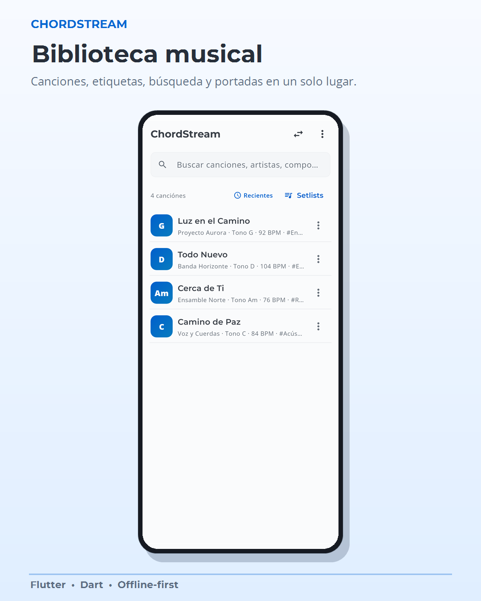
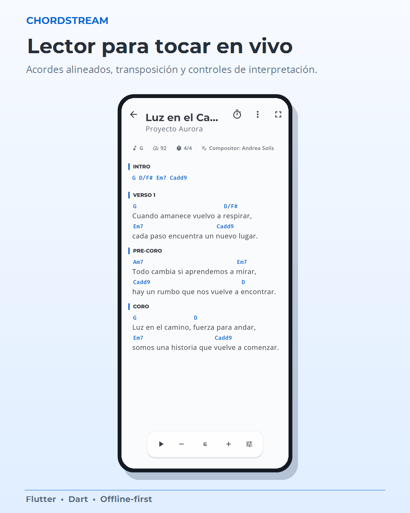
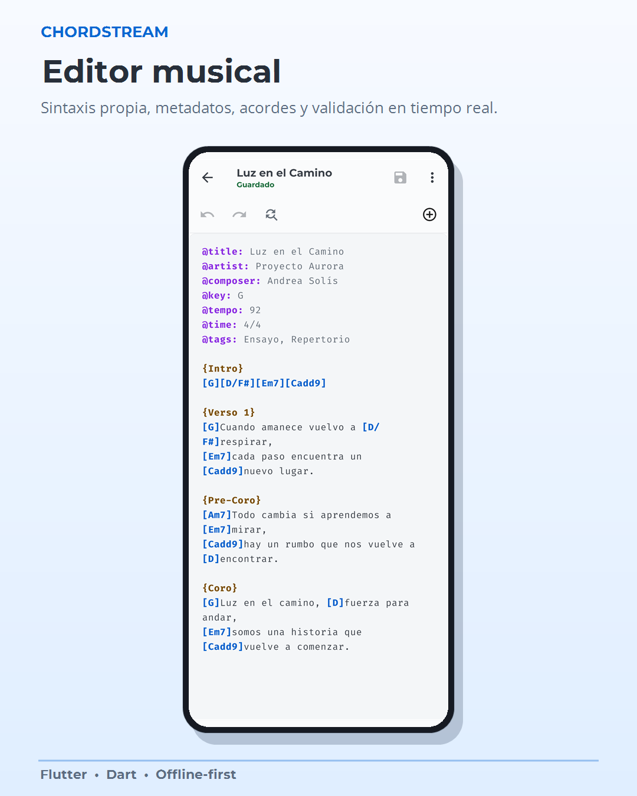
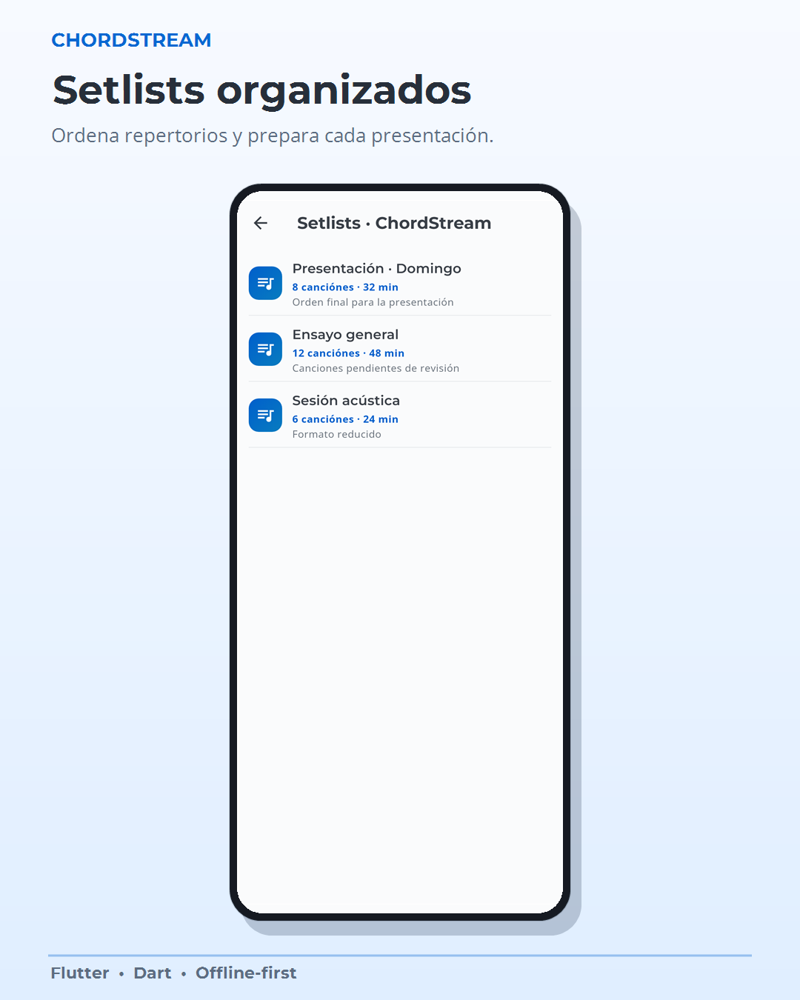
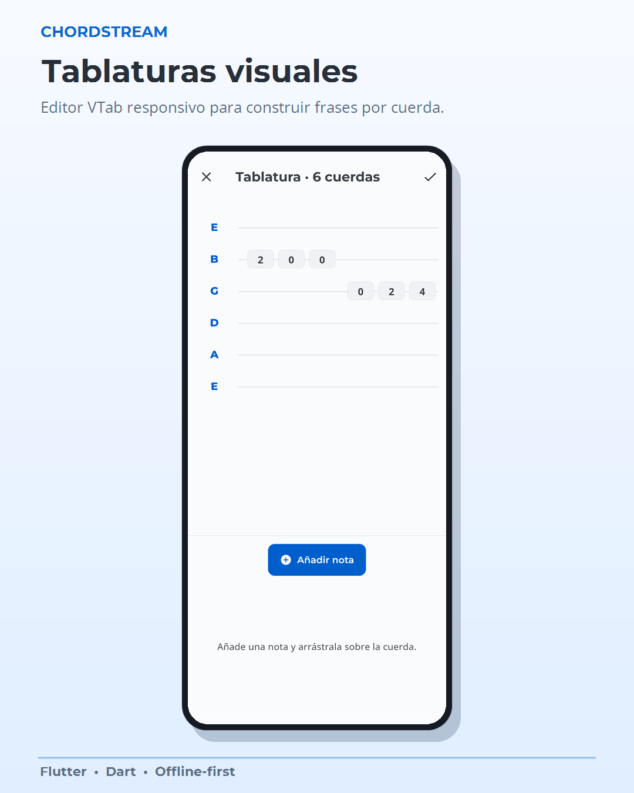
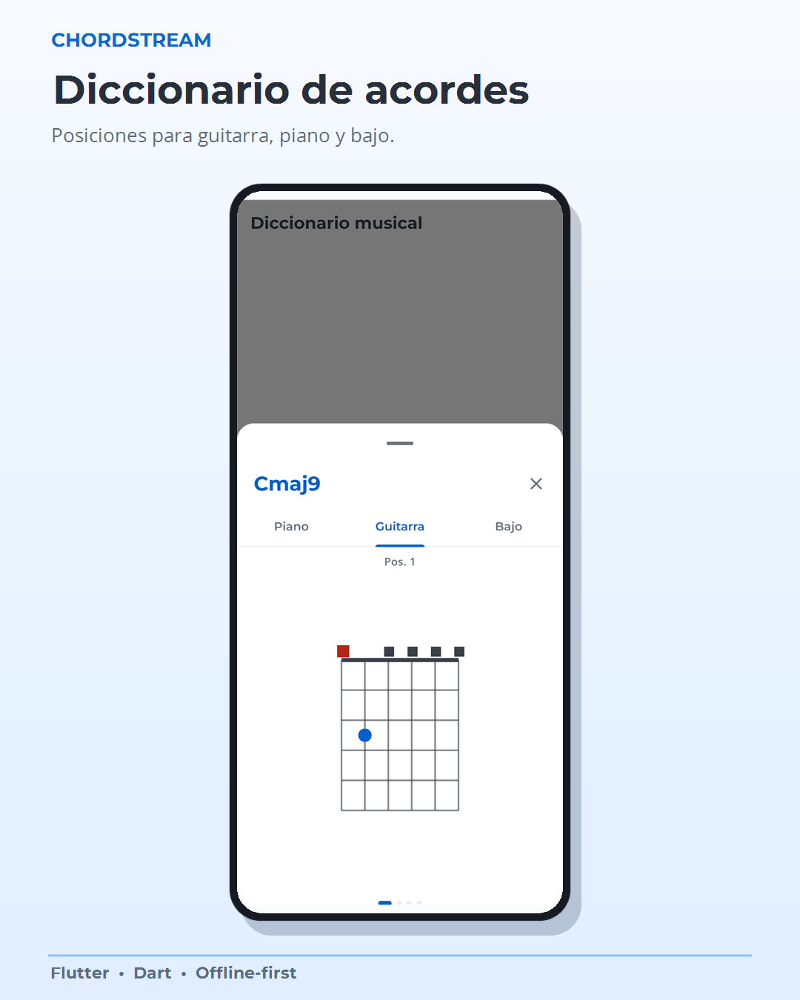

# ChordStream

**An Android songbook for rehearsals and live performance.**

Organize songs, adapt chord charts to each musician, and keep the setlist ready
to play. ChordStream combines a local song library with collaborative workspaces.

**Flutter · Dart · SQLite · PHP · MySQL**

[Product tour](docs/PRODUCT_TOUR.md) · [Architecture](docs/ARCHITECTURE.md) · [Engineering decisions](docs/TECHNICAL_NOTES.md) · [Validation](docs/VALIDATION.md) · [Español](#español)

**Created by [José Pablo Quirós Vásquez](https://github.com/jquirosv).**

This repository is the public case study for ChordStream. The application source
code, tests, and development history are maintained in a separate private
repository. This showcase contains documentation and demonstration images.

## The problem

Musicians often prepare a repertoire across PDFs, screenshots, and messages.
Keys change, versions drift apart, and singers and instrumentalists need different
views of the same song. ChordStream keeps one structured song and derives the
reading view from its musical content and the player's instrument.

## What I built

- A Flutter application for Android, including the library, editor, reader,
  setlists, and instrument-specific views.
- A Dart music engine with a lexer, parser, musical tree, transposition, and filters.
- Local SQLite persistence, drafts, backup import/export, and recoverable deletion.
- A PHP/MySQL API for accounts, group permissions, shared songs, and synchronization.

## Main features

| Area | Capabilities |
| --- | --- |
| Library | Search, tags, covers, sorting, and song organization. |
| Editor | Syntax highlighting, validation, preview, and draft recovery. |
| Reader | Chord-aligned lyrics, transposition, auto-scroll, sections, and metronome. |
| Instruments | Guitar, bass, vocals, harmony, custom tunings, and chord diagrams. |
| Tablatures | Text tabs and a visual tablature builder. |
| Setlists | Song ordering and performance settings. |
| Collaboration | Groups, invitations, roles, and revision conflict handling. |
| Portability | ChordPro conversion and native backup import/export. |

Individual mode works locally without an account or Internet connection.
Group changes require connectivity and confirmation from the server.

## Screenshots

Real Flutter widgets with original demonstration content and fictional data.

| Library | Live reader | Editor |
| :---: | :---: | :---: |
|  |  |  |

| Setlists | Visual tablature | Chord dictionary |
| :---: | :---: | :---: |
|  |  |  |

[Group collaboration](docs/assets/07_colaboracion.png) ·
[Full product tour](docs/PRODUCT_TOUR.md) ·
[Image provenance](docs/assets/README.md)

## Technologies

| Layer | Technologies |
| --- | --- |
| Application | Flutter, Dart, Material, Provider, Canvas/CustomPainter |
| Music engine | Dart lexer/parser, musical tree, validation, and transposition |
| Local data | SQLite/sqflite, secure storage, files, and compressed backups |
| Backend | PHP, PDO, MySQL, REST, and JSON |
| Engineering | Git, Flutter Test, PHP tests, OpenAPI, and GitHub Actions |

## Engineering decisions

- **Preserve the original song:** transposition and instrument filtering operate
  on an in-memory musical tree rather than rewriting the user's text.
- **Keep lyrics readable:** chord placement uses a separate layout layer so
  embedded chords do not break words and natural line wrapping.
- **Protect collaborative edits:** API revisions, transactions, and idempotency
  handle concurrent changes and retries.
- **Keep personal work available:** the individual library uses local SQLite;
  group writes are confirmed by the server.

[Architecture](docs/ARCHITECTURE.md) ·
[Technical challenges and decisions](docs/TECHNICAL_NOTES.md)

## Project status

- Code version reviewed: **1.1.1+16**.
- Client platform: **Android 7.0 / API 24 and later**.
- Local verification on October 20, 2026: **282 Flutter tests and 31 PHP tests passed**;
  OpenAPI validation and parity of **60 API operations** also passed.
- The screenshots demonstrate the interface; this repository does not distribute
  application binaries or provide a public demo account.

[Validation evidence and scope](docs/VALIDATION.md).

## Author

[José Pablo Quirós Vásquez](https://github.com/jquirosv) · Costa Rica · [LinkedIn](https://www.linkedin.com/in/jquirosv/)

This is one project in my portfolio. Visit my profile to explore my background
and other projects.

---

## Español

Español — presentación completa

## ChordStream en español

**Un cancionero para Android pensado para ensayos e interpretación en vivo.**

Organiza canciones, adapta los acordes a cada músico y mantén el repertorio listo para tocar. ChordStream combina una biblioteca local con espacios de trabajo colaborativos.

**Flutter · Dart · SQLite · PHP · MySQL**

[Recorrido del producto](docs/PRODUCT_TOUR.md) · [Arquitectura](docs/ARCHITECTURE.md) · [Decisiones técnicas](docs/TECHNICAL_NOTES.md) · [Validación](docs/VALIDATION.md). Documentación ampliada en inglés.

**Creado por [José Pablo Quirós Vásquez](https://github.com/jquirosv).**

Este repositorio es la ficha pública de ChordStream. El código de la aplicación, las pruebas y su historial de desarrollo se mantienen en un repositorio privado independiente. Aquí se presentan documentación e imágenes de demostración.

### El problema

Los músicos suelen preparar su repertorio entre archivos PDF, capturas y mensajes. Cambian las tonalidades, las versiones se separan y cantantes e instrumentistas necesitan vistas distintas de una misma canción. ChordStream conserva una canción estructurada y genera la vista de lectura a partir de su contenido musical y del instrumento del intérprete.

### Qué desarrollé

- Aplicación Flutter para Android con biblioteca, editor, lector, setlists y vistas por instrumento.
- Motor musical en Dart con analizador léxico, parser, árbol musical, transposición y filtros.
- Persistencia local SQLite, borradores, importación y exportación de respaldos y eliminación recuperable.
- API PHP/MySQL para cuentas, permisos de grupo, canciones compartidas y sincronización.

### Funcionalidades principales

| Área | Capacidades |
| --- | --- |
| Biblioteca | Búsqueda, etiquetas, portadas, ordenación y organización de canciones. |
| Editor | Resaltado de sintaxis, validación, vista previa y recuperación de borradores. |
| Lector | Letras con acordes alineados, transposición, desplazamiento automático, secciones y metrónomo. |
| Instrumentos | Guitarra, bajo, voz, armonía, afinaciones personalizadas y diagramas de acordes. |
| Tablaturas | Tablaturas de texto y editor visual. |
| Setlists | Orden de canciones y ajustes de interpretación. |
| Colaboración | Grupos, invitaciones, roles y gestión de conflictos de revisión. |
| Portabilidad | Conversión ChordPro e importación y exportación de respaldos nativos. |

El modo individual funciona localmente sin cuenta ni conexión a Internet. Los cambios de grupo requieren conexión y confirmación del servidor.

### Capturas

Widgets reales de Flutter con contenido original de demostración y datos ficticios.

| Biblioteca | Lector en vivo | Editor |
| :---: | :---: | :---: |
|  |  |  |

| Setlists | Tablaturas visuales | Diccionario de acordes |
| :---: | :---: | :---: |
|  |  |  |

[Colaboración en grupos](docs/assets/07_colaboracion.png) · [Recorrido completo](docs/PRODUCT_TOUR.md) · [Procedencia visual](docs/assets/README.md)

### Tecnologías

| Capa | Tecnologías |
| --- | --- |
| Aplicación | Flutter, Dart, Material, Provider y Canvas/CustomPainter |
| Motor musical | Analizador léxico y parser en Dart, árbol musical, validación y transposición |
| Datos locales | SQLite/sqflite, almacenamiento seguro, archivos y respaldos comprimidos |
| Backend | PHP, PDO, MySQL, REST y JSON |
| Ingeniería | Git, Flutter Test, pruebas PHP, OpenAPI y GitHub Actions |

### Decisiones de ingeniería

- **Conservar la canción original:** la transposición y los filtros por instrumento actúan sobre un árbol musical en memoria, sin reescribir el texto del usuario.
- **Mantener legible la letra:** los acordes usan una capa de composición independiente para evitar que rompan palabras y saltos naturales de línea.
- **Proteger las ediciones compartidas:** revisiones de API, transacciones e idempotencia permiten gestionar cambios concurrentes y reintentos.
- **Mantener disponible el trabajo personal:** la biblioteca individual utiliza SQLite local; el servidor confirma las escrituras de grupo.

[Arquitectura](docs/ARCHITECTURE.md) · [Retos y decisiones técnicas](docs/TECHNICAL_NOTES.md)

### Estado del proyecto

- Versión de código revisada: **1.1.1+16**.
- Plataforma: **Android 7.0 / API 24 y posteriores**.
- Verificación local registrada el **20 de octubre de 2026**: **282 pruebas Flutter y 31 PHP aprobadas**; también se aprobaron la validación OpenAPI y la paridad de **60 operaciones de API**.
- Las capturas muestran la interfaz. Este repositorio no distribuye la aplicación compilada ni ofrece una cuenta pública de demostración.

[Evidencia y alcance de validación](docs/VALIDATION.md).

### Autor

[José Pablo Quirós Vásquez](https://github.com/jquirosv) · Costa Rica · [LinkedIn](https://www.linkedin.com/in/jquirosv/)

Este es uno de los proyectos de mi portafolio. En mi perfil puedes consultar mi formación y los demás proyectos.

© 2026 José Pablo Quirós Vásquez. See [COPYRIGHT.md](COPYRIGHT.md).
