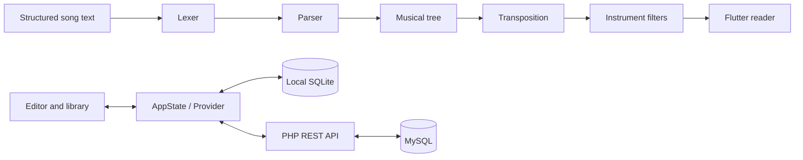

# ChordStream architecture

This document describes the implementation maintained in the private development
repository. It is an architectural overview, not a copy of the application source.

## Components

| Component | Responsibility |
| --- | --- |
| Flutter UI | Library, editing, reading, setlists, instrument views, and dialogs. |
| Music engine | Tokenization, parsing, validation, key handling, and transformations. |
| State coordinator | User actions, selected workspace, data operations, and reading state. |
| Local repository | SQLite persistence, drafts, personal library, and recoverable deletion. |
| API client | Authenticated HTTP requests and revision-aware group operations. |
| PHP API | Authentication, membership, permissions, songs, setlists, and synchronization. |
| MySQL | Shared workspace data, relations, revisions, and transactional changes. |

## Data boundaries

The individual library is available locally without a server account. Group
operations require a connection and are confirmed by the API. A failed or pending
remote write is not presented as synchronized.

The source song text remains the editable representation. The music engine builds
an in-memory tree for transposition and instrument filtering. This separates the
stored arrangement from the view used during a performance.

## Collaboration

The API checks membership and permissions for shared resources. Optimistic
revisions detect conflicting writes, while idempotency keys support safe retries.
Related database mutations and synchronization events are committed together.

## Scope

The implemented client targets Android. The app focuses on song preparation and
reading; it does not implement audio-track playback, recording, MIDI, or pedal control.

[Back to the project overview](../README.md)
