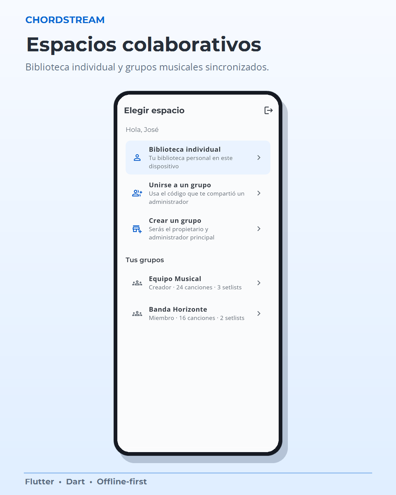
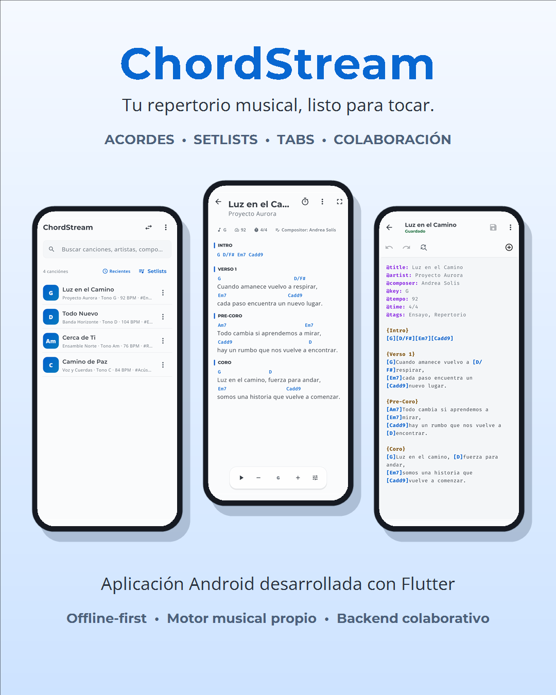

# Product tour

[← ChordStream](../README.md) · [Asset provenance](assets/README.md)

ChordStream follows a musician's preparation workflow: collect a repertoire, edit its musical structure, adapt the view to an instrument, and arrange the performance. The images show real Flutter widgets in presentation frames with original demonstration content and fictional records.

## From library to rehearsal

| Find the repertoire | Read during a performance |
| :---: | :---: |
|  |  |

The library supports search, tags, covers, and sorting. The reader derives chord-aligned lyrics from structured song text, with transposition, section navigation, auto-scroll, and metronome support. Individual work stays available locally without an account or network connection.

## Prepare an arrangement

| Edit the song | Build a tablature |
| :---: | :---: |
|  |  |

The editor provides syntax highlighting, validation, preview, and recoverable drafts. A Dart lexer and parser build an in-memory musical tree. Transposition and instrument filters transform that tree while preserving the stored source text. Text tablatures and a visual builder support instrument-specific material.

## Get the performance ready

| Order the set | Check chord shapes |
| :---: | :---: |
|  |  |

Setlists keep song order and performance settings together. Instrument views include guitar, bass, vocals, and harmony, with custom tunings and chord diagrams. ChordPro conversion and native compressed backups support moving a repertoire between compatible workflows.

## Work with a group

The PHP/MySQL API manages accounts, invitations, membership, roles, shared songs, and synchronization. Group writes require connectivity and server confirmation. Revisions identify stale changes, idempotency protects retries, and transactions keep related mutations consistent.

## Presentation overview

The original portrait presentation remains available here. The README opens with the project's original horizontal logo and wordmark, copied unchanged from its branding resources. Branding and presentation graphics are distinct from test or device evidence.

[Architecture](ARCHITECTURE.md) · [Engineering decisions](TECHNICAL_NOTES.md) · [Validation](VALIDATION.md)
